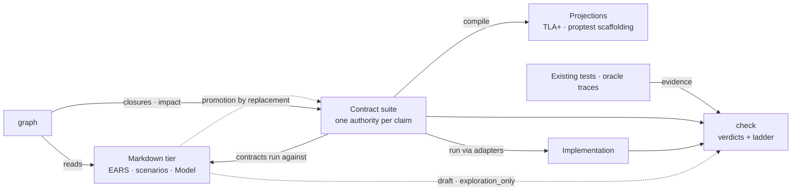

# 2026-11-16 — Authority lattice: problems, goals, and the single-source-of-truth question

**Status: research synthesis. No implementation is authorized or planned from
this document.** It consolidates the Oct 7/16 reverse-derivation evaluations,
the Nov 2 ecosystem grounding, the Nov 10 executable-contracts grounding and
grilling session, and the Nov 11 decision of record. Purpose: one
self-contained statement of (a) the problems the program exists to solve,
(b) the desired end state, (c) what was rejected and why, and (d) the open
decisions.

**Amnesia-safe:** every claim below is either grounded in a cited repo file,
a cited conversation transcript, or explicitly marked as inference.

## Provenance

| Source | Where | Date | Contribution |
|---|---|---|---|
| ChatGPT "Executable Specification Strategy" | `~/cotorreo/raw/_conversations/chatgpt/6aedeb14-e2d4-83e9-9428-ff6fff6fcf37/` (indexed in cotorreo; consolidated in the Nov 10 grounding doc) | 2026-11-10 | T1/T2: tests become the executable specification; openspec specs become "docstrings of each test"; specs synthesized from accepted contracts. T3 correction: generated tests are not independent evidence. T5 build spec: contract suite + adapters + evidence + OpenSpec projections. |
| ChatGPT "Specodelic architecture discussion" | `~/cotorreo/raw/_conversations/chatgpt/6ae7f1e9-827c-83e9-887a-351a8e5a2d84/` | 2026-11-01/02 | Four drifts (spec, architecture, comprehension, evidence); C4/`realization` gap; six acceptance conditions; four interoperability primitives; "no second authoritative copy". |
| Cotorreo thread "Evaluate specodelic's ability to derive specs from code" | `~/cotorreo/synthesized/_conversations/f4f59d6ba99c-evaluate-specodelic-ability-to-derive.md`; members under `~/cotorreo/raw/_conversations/` | 2026-10-07 | Seven-provider reverse-derivation evaluation: no extractor exists; spec-first by design; leave reverse-derivation out of scope. |
| pi session — reverse-derivation grounding | `.pi/agent/sessions/--var-home-sasha-para-areas-dev-gh-charly-specodelic--/2026-10-07T20-04-29-715Z_01a117f7-ab93-76cd-a21a-898c2a896223.jsonl` | 2026-10-07 | Mutation test on pybreaker: only 1 of 5 questionable behaviors pinned by tests; draft-from-tests would codify the other 4. |
| Codex design brief — reverse-derivation affordances | `.codex/sessions/2026/10/16/rollout-2026-10-16T18-19-50-01a14695-e3d2-7b01-b4d1-b4666020a4d7.jsonl` | 2026-10-16 | Ranked the candidates; "**do not build** draft-from-tests now — it's the only candidate that grazes the anti-goal." |
| pi session — executable-contracts grill | `.pi/agent/sessions/--var-home-sasha-para-areas-dev-gh-charly-specodelic--/2026-11-10T21-35-15-428Z_01a1c762-fbe2-7322-b029-3e673f48dca0.jsonl` | 2026-11-10 | The proposal, the four test populations, the tautology argument, the no-derived-spec-layer resolution, tiering, three verbs. |
| Grounding doc | `.wai/resources/research/2026-11-10-executable-contracts-build-spec-grounding.md` | 2026-11-10 | Claim-by-claim grounding of the external build spec against the implementation (C-1..C-8, G-1..G-5, D-1..D-7). |
| Design resolutions | `.wai/resources/research/2026-11-10-executable-contracts-design-resolutions.md` | 2026-11-10 | Ten resolved design decisions, Rule-of-5 reviewed (4/4 HIGH TypeSafe-verified). |
| Ecosystem grounding | `.wai/resources/research/2026-11-02-ecosystem-correspondence-investigation-grounding.md` | 2026-11-02 | Four drifts, C4/realization gap, six acceptance conditions, D-1..D-9, four primitives. |
| Decision of record | `openspec/decisions/2026-11-11-executable-contracts-direction.md` | 2026-11-11 | Ratifies the executable-contracts direction and the five-step migration sequence. |
| Anti-goal | `openspec/changes/archive/2026-09-30-add-spk-migrate/proposal.md:24`; `design.md` D4 | 2026-09-30 | "No auto-derivation of constraints/properties from prose"; migrate is scaffolding, not derivation. |
| Program state | `.whisper/branches/main/notes.md` (2026-11-15 entry) | 2026-11-15 | Executable-contracts direction at step 1 of 5; steps 2–5 unstarted. |

## 1. What the program is trying to solve

The Nov 2 investigation names four drifts. They are the problem statement.

| Drift | What it is | Current evidence |
|---|---|---|
| **Spec drift** | The spec can be internally coherent and still not describe the implementation. Nothing checks spec against code. | Nov 2 turn 1: "internal spec coherence ≠ implementation conformance". `compile` states "source of truth is the spec file"; `verify` checks compiled spec artifacts, not the implementation. |
| **Architecture drift** | No C4/component/`realization` concept exists, so system structure is prose-only and unverifiable. | Nov 2 grounding: 47 `spec.md` files at the time, no component/realization concept; graph views collapse rows to intents, not components. |
| **Comprehension drift** | Design intent and rationale are buried; reviewers skim prose while the executable truth is elsewhere. | Nov 2 (Naur theory-building / comprehension debt); Nov 10 grill (the "proposals as test diffs are harder to skim" loss). |
| **Evidence drift** | Three evidence vocabularies and several test populations; no single rung; staleness is detected in one tool but not all. | Nov 2 D-1; Nov 10 grounding G-2/G-3 (generated fragments vs hand-authored tests; sidecar bindings). |

Concrete symptoms, as of the grounding docs (recorded, not re-measured here):

1. **Dual-format mirror.** The `## Requirements` mirror is a second copy of the
   normative body; the Nov 2/Nov 10 work repeatedly convicted it as a drift
   *generator*, not a convenience.
2. **Mandatory four layers.** `model_present` requires States + Transitions in
   every file, including data-shaped work where a Model is overhead
   (`src/lint/rules.rs`; Nov 2 D-7).
3. **Vacuous checking.** Generators compile to `Just(name)` constants; property
   cells without a fragment compile to `todo_predicate!`; the kata verdict
   described a "checked shell around an unchecked core"
   (`specodelic-l8wp`; Nov 10 grill).
4. **Tests are not independent evidence.** Generated fragments are projections
   of the spec (tautology); `tests/conformance_matrix.rs` is hand-authored but
   its expectations come from the checker specs; existing implementation tests
   are descriptive, not normative (Nov 10 resolutions §1).
5. **Bindings live in the wrong layer.** catitas carried a `binding` column in
   spec rows pointing at pytest tests; `row_shape_closed` rejects it, and the
   sanctioned binding lives in `.espectacular/` sidecars. A test pointer in a
   spec row looks like truth without independence.
6. **No honest exploration tier.** Markdown sketches are implicitly normative;
   there is no `exploration_only` default, no sketch → Model → contract ladder
   (Nov 10 resolution §8).
7. **No progressive formalization.** Four layers or nothing; no demand-gated
   Model; tier-0 "contract-verified" is not yet a complete answer
   (Nov 2 D-7; Nov 10 resolution §5).
8. **Composition is file-level only.** Typed references, acyclicity, and packs
   exist, but component realization and cross-system composition are not
   first-class (Nov 2 turn 1).
9. **Tool surface sprawl.** `lint`, `new`, `compile`, `model-check`, `verify`,
   `conform`, `audit`, `graph`, `rename`, `merge`, `refactor`, `orchestrate`,
   `doctor` — overlapping evidence verbs (Nov 10 resolution §6).
10. **Program stalled.** The executable-contracts direction is at step 1 of 5;
    the shipped tool remains spec-first (`.whisper/branches/main/notes.md`,
    2026-11-15).

## 2. The desired end state

### 2.1 The authority lattice

The design's one-sentence statement (Nov 10 resolutions):

> Code is truth, markdown is reviewed intent and simulation, proposals carry
> both — spec and implementation cannot drift because they never share an
> artifact.

The lattice, not a single file:

The roles:

| Layer | Role | Authority |
|---|---|---|
| **Contract suite** | Hand-authored executable tests with DI, origin-annotated | **Normative** — sole source of behavioral truth |
| **Model** | States/Transitions → TLA+/IR → embedded model checker | **Adapter #0** — simulation, not truth; demand-gated |
| **Markdown tier** | EARS intent + scenario blocks + optional Model | **Non-normative** — reviewed intent and design surface |
| **Compiled artifacts** | TLA+, proptest scaffolding, TOML | **Projections** — never evidence |
| **Existing tests / oracle traces** | Sidecar-bound implementation tests, recorded traces | **Evidence** — descriptive, never normative unless promoted |
| **`check`** | Suites × adapters → verdicts + scope-digested, staleness-checked evidence | **Judge** — does not own truth |
| **`graph`** | ACSet closures, blast radius, views | **Relate** — computed projection, never a stored second source |
| **`doctor`** | Advisory: tier smells, EARS advisory, missing triggers | **Advise** — never a gate |

### 2.2 Goals

Status legend: **shipped** (observable today), **direction** (ratified in the
Nov 11 decision, not implemented), **resolved** (design settled, not built),
**open** (decision still pending).

| # | Goal | Meaning | Status |
|---|---|---|---|
| G1 | **One authority per claim** | Exactly one normative home per behavioral claim; everything else is a projection or evidence. Not one file — one owner per claim. | direction |
| G2 | **Independence** | Evidence must not be derived from the thing it judges. Contract suite authored against intent/oracle, run through DI adapters; `origin` separates `authored-from-intent` from `characterizing-observed`. | direction |
| G3 | **Honest evidence limits** | Closed verdict taxonomy, scope digests, staleness, first-class `unknown`/`underspecified`; never a vacuous pass. | partly shipped (`verify`, `conform`, `audit`) |
| G4 | **Drift impossible by construction** | No derived spec layer, no dual-format mirror, one-way citations; the artifact never has two authoritative copies. | direction |
| G5 | **Compositional typed structure** | Contracts bind components; typed references; closures/blast radius; one vocabulary (`Reference/Relation/Observation/Assessment`) as a **computed** graph, never a stored second source. | adopted; graph/ACSet partly shipped |
| G6 | **Specs where meaning is authoritative; bindings near code** | External behavior lives in independent specs; local obligations live code-adjacent. | open (Nov 2 principle) |
| G7 | **Architecture/C4 realization** | Components and realization edges; views generated from one snapshot; structure derived from source facts — never hand-drawn. | open (D-4, D-6, D-8) |
| G8 | **Extension without editing** | Packs, kind narrowing, append-only tables; a consumer extends via typed references, never by editing the producer. | shipped (packs) |
| G9 | **Simulate before code** | Model = adapter #0: model-check, counterexamples, design discovery on the thinking surface. | machinery shipped; reframe not built |
| G10 | **Pressure without implementation** | Contracts run against the Model exactly as against real adapters; a failing contract is a Model defect by default; speculative contracts are flagged and excluded from the normative set. | resolved |
| G11 | **Progressive formalization** | Sketch → Model → tier 0 → tier 1; tier-0 "contract-verified" is complete; Models demand-gated by a recorded formalization trigger. | direction |
| G12 | **Reviewability** | Markdown tier keeps EARS + scenarios + Model as reviewed intent; proposals carry rationale + markdown delta + contract diff, explicitly separated. | partly shipped (corpus/openspec) |
| G13 | **Agent loop** | One binary + markdown: `spk new`, `check --draft`, `graph`; instant structural verdict and impact; no toolchain needed to sketch. | partly shipped |
| G14 | **Small surface** | Three verbs: `check` (judge), `graph` (relate), `doctor` (advise); fuse, don't accrete. | resolved |
| G15 | **Migration safety** | Preservation floor; in-flight work consumed, never abandoned; demotion earned by measured coverage, never a vote. | direction; step 1/5 |

### 2.3 What "single source of truth" does and does not mean

**Does:**

- One normative owner per claim (G1).
- No second authoritative copy of an existing decision, contract, or evidence
  (Nov 2 acceptance condition 6).
- One computed graph over those owners, not a stored graph database
  (Nov 2 turn 9: the four primitives are a *computed* graph).
- One parser/one format; one-way citations; no mirror (Nov 10 resolution §9).
- One ladder of evidence: sketch → model → tier 0 → tier 1.

**Does not:**

- One file. Composition needs many contracts and components.
- One universal semantic kernel or merged repositories — both were explicitly
  rejected in the Nov 2 investigation (turn 9 §10).
- One tool. Specs, contracts, evidence, and views have different owners; the
  constraints between sibling tools are deliberate.
- A derived spec layer. That layer would be a copy of the truth wearing the
  truth's clothes.
- A mandatory four-layer schema. Formalization is demand-gated.

## 3. What was rejected, and why

### 3.1 "Derive specs from tests"

**Rejected.** Evidence:

- The Oct 7 seven-provider evaluation concluded that no extractor exists and
  that "the tool functions as a spec authoring/review gate, not an inference
  engine" (`cotorreo/synthesized/_conversations/f4f59d6ba99c-…`).
- The pi session's mutation test on pybreaker: **only 1 of 5** questionable
  behaviors was pinned by the tests; "a draft-from-tests reverse-derivation
  mode would codify the other 4" (`2026-10-07T20-04-29…`).
- The codex design brief ranked draft-from-tests last: "**do not build**
  draft-from-tests now — it's the only candidate that grazes the anti-goal"
  (`2026-10-16T18-19-50…`).
- The `migrate` proposal records the anti-goal: "no auto-derivation of
  constraints/properties from prose — the scaffold is a skeleton, the agent
  fills it" (`openspec/changes/archive/2026-09-30-add-spk-migrate/proposal.md:24`).

The reason is not tooling difficulty; it is epistemic. Tests verify what the
code *does*, not what it *should do*. Deriving from them codifies bugs,
edge-case workarounds, and implementation leaks.

### 3.2 "All existing tests are the source of truth"

**Rejected.** The Nov 10 grill separated four populations:

| Population | Example | Status |
|---|---|---|
| (a) generated fragments | `specodelic/*_props.rs` | projection of a source — never evidence |
| (b) checker pinners | `tests/conformance_matrix.rs` | pins the tool; expectations from specs |
| (c) implementation tests | wild's sidecar-bound pytest | descriptive, not normative |
| (d) **contract suites** | new | **normative — authored-first, adapter-bound** |

Key quotes from the Nov 10 session:

> "An **independently authored behavioral contract suite** is authoritative —
> not the tests that `spk compile` emits. The generated `*_props.rs` fragments
> are a *projection of the specification* … spec → generated tests →
> implementation is a tautology loop."

> "When you say 'tests are the source of truth' — which population?"

> "If you say 'all tests,' you inherit every accident of the existing suite —
> including population (a), which would make the authority claim circular
> again."

Verdict: only a **new, independently authored contract suite** qualifies.
Existing tests are evidence, bound through espectacular sidecars; they are not
truth.

### 3.3 "Specs are derived from those tests"

**Rejected by deletion.** The initial proposal (external T1/T2) was "plain text
is docstrings in the tests, extracted." Two failure modes were identified:

- **Extraction-as-writer** (templates or LLM summarization) can say anything;
  nothing checks paraphrase against behavior — drift with the arrow flipped.
- **Extraction-as-splicer** (byte-identical docstring relocation) is safe but
  still a derived layer, a second artifact, and recursion.

The user's own "simpler way" push led to the final resolution:
**no derived spec layer at all** — prose lives in docstrings, read in place
(Nov 10 resolutions §3). Promotion of a sketch to normative happens only by
replacement — writing the contract — never by elevation.

### 3.4 "Enforce it now"

**Not rejected as a direction; rejected as an immediate gate.** The Nov 11
decision record adopts contract suites as the direction, then states:

> "**Relationship to deployed behavior:** None today. No spec, no gate, no
> command changes with this decision."

Why enforcement is sequenced instead of switched on:

1. The adapter-registry shape (annotations vs sidecars) is undecided; the
   wild-core slice exists to decide it empirically.
2. The contract front-end and graph port do not exist; the corpus must keep
   working additively until they do.
3. Demotion requires measured contract coverage, not a vote — the
   self-hosting inversion must reach the conformance matrix's coverage first.
4. Current behavior is the preservation floor; in-flight work is consumed,
   never abandoned.

Status: step 1 of 5 shipped (`add-evidence-audit`); steps 2–5 unstarted
(`.whisper/branches/main/notes.md`, 2026-11-15).

## 4. Open decisions

From the two grounding docs. None has a proposal yet; none should get one
until the question is answered.

| ID | Question | Decider |
|---|---|---|
| D-1 | Reconcile the three evidence vocabularies: the four primitives, the audit class set `{current, stale, unchecked, contradicted, binds_nothing, new}`, and conform's five verdicts. | Side-by-side table over real examples from this repo, one `dont` claim, one espectacular contract. |
| D-2 | Who owns assessment policy? Genesis vs a companion vs vampiro vs a specodelic pack. | Write the policy grammar for one rule in each candidate and compare. |
| D-3 | Cross-tool reference/id grammar that round-trips `-`⇔`.`, directory-derived `spec.md` ids, and literal `_`. | Can every id in this corpus round-trip through one resolver? |
| D-4 | Where do architecture declarations live: wai artifacts, a specodelic pack, or openspec with a layer sidecar? | Draft the same component declaration in all three homes; check lint/validate/archive-companion. |
| D-5 | Espectacular: derive-at-check-time vs pinned digest. | Measure `ah check` recompute cost; diff pinned-digest vs full-persistence staleness behavior. |
| D-6 | Vampiro re-scope of the source-facts experiment (its Rust edges are advisory until frontend parity). | Scope one extraction task in vampiro; measure completeness reporting against the six acceptance conditions. |
| D-7 | Typed-optional kinds (`Contract · Component · StateMachine · Decision · Property`) vs the four mandatory layers. | Prototype one pack first; run `spk lint` over a hybrid corpus; let `model_present`/`pack_shape` name the blocker. |
| D-8 | First vertical slice target (Python/TS subproject vs advisory Rust slice). | Pick after D-6 resolves. |
| D-9 | Map the six acceptance conditions to experiments E1–E4. | The mapping table itself; two conditions mapping to nothing is the gap list. |
| D-10 | Exact contract-verdict mapping when `check` consumes the audit vocabulary. | No fourth vocabulary; write the mapping when the fusion change is proposed. |
| D-11 | C4 context/container declaration home (carried D-4 from Nov 2). | Same as D-4. |
| D-12 | "Contract suite" vs espectacular's "contract tests" naming collision. | One line in user-facing docs; no schema change. |
| D-13 | Migration sequence ratification. | The sequence is recorded; step-gates are the real gate. |

### The six acceptance conditions (Nov 2, verbatim)

1. All relevant source files are accounted for or explicitly marked unsupported.
2. Cross-tool references resolve to real, versioned artifacts.
3. The architectural violation is detected.
4. The behavioral verification result retains its actual evidence limits.
5. A generated C4 view and an impact explanation trace back to the same snapshot.
6. No additional authoritative copy of existing decisions, contracts or evidence is introduced.

Condition 6 is the single-source goal in testable form.

## 5. Candidate goal statement

> **One authority per claim.** Claims are compositional and typed. The design
> surface is executable before code — a Model that can be simulated and
> pressure-tested against the same contracts real implementations will face.
> Evidence is independent and honestly graded. Everything else is a projection.
> Formalization is demand-gated. The agent loop stays one binary plus markdown.

The one-line test for any proposal: **does it introduce a second authoritative
copy, or does it only add a projection, an adapter, or evidence?**

## 6. Validation and limitations

- **Grounded:** the drifts, the rejections, the test-population split, the
  decision statuses, and the open questions are all recorded in the cited
  docs/transcripts.
- **Not re-measured:** the exact corpus counts and the current status of every
  ticket were not re-derived for this synthesis; the counts named here are the
  ones recorded in the source docs at their dates.
- **Inference:** the grouping into G1–G15 and the "lattice" framing are this
  document's synthesis, not a verbatim decision. The individual decisions they
  summarize are sourced.
- **Scope:** no code, spec, gate, or command changed. This is a research
  artifact only.
- **Not part of this program:** Revision 22 (prose-only outbound-leaf
  consolidation) and the 0.13 gates (`row_shape_closed`,
  `ref_kind_compatible`) are unrelated to the tests-as-truth question; they
  changed format shape and typing, not authority.

## 7. Suggested next actions

1. **D-1 first.** The evidence-vocabulary reconciliation unblocks the rest.
2. **D-9 second.** Map the six acceptance conditions onto E1–E4; the gaps are
   the real program.
3. **Ratify or amend the goal set.** If G1–G15 are the right goals, turn this
   into a decision note; if not, correct it before any proposal.
4. **Choose the next program step.** The recorded sequence says: wild-core
   slice (step 2) before any front-end proposal. The alternative risk profile
   is self-hosting first (dogfood before foreign consumer); that choice has
   not been ratified.
